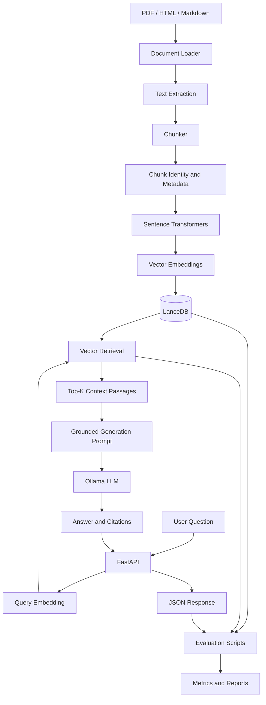

# Cost-Efficient RAG Application

A document question-answering system built with Retrieval-Augmented Generation (RAG), local language models, semantic embeddings, and vector search.

The project explores how to build a reproducible RAG pipeline while measuring retrieval quality, answer-generation latency, token usage, and estimated storage requirements at larger vector-collection sizes.

**Repository:** https://github.com/student-kshitish/cost-efficient-rag

---

## Table of Contents

- [1. Project Overview](#1-project-overview)
- [2. Architecture](#2-architecture)
- [3. Technology Stack](#3-technology-stack)
- [4. Project Structure](#4-project-structure)
- [5. Installation and Setup](#5-installation-and-setup)
- [6. Running the Application](#6-running-the-application)
- [7. Evaluation Methodology](#7-evaluation-methodology)
- [8. Retrieval Evaluation Results](#8-retrieval-evaluation-results)
- [9. Answer Generation and Latency](#9-answer-generation-and-latency)
- [10. Scalability Estimates](#10-scalability-estimates)
- [11. Vector Database Comparison](#11-vector-database-comparison)
- [12. Cost and Performance Trade-offs](#12-cost-and-performance-trade-offs)
- [13. Limitations](#13-limitations)
- [14. Future Improvements](#14-future-improvements)
- [15. Reproducibility](#15-reproducibility)

---

## 1. Project Overview

The application answers questions about documents by retrieving relevant passages and supplying them to a language model as context.

Instead of relying exclusively on information stored in the model's parameters, the system retrieves supporting text from an indexed document collection.

### Core capabilities

- PDF, HTML, and Markdown document loading.
- Configurable chunk size and overlap.
- Semantic embeddings using Sentence Transformers.
- Vector storage and similarity search using LanceDB.
- Metadata associated with indexed passages.
- Local LLM inference through Ollama.
- FastAPI endpoints for health checks, statistics, and question answering.
- Source citations in generated responses.
- Abstention behavior for questions that cannot be answered from available context.
- Idempotent ingestion to reduce duplicate indexing.
- Retrieval metrics, latency measurement, and scalability estimates.
- Automated tests.

### Design objective

The primary objective is to build a locally runnable RAG application and measure its behavior before considering larger-scale deployment.

The project distinguishes actual measurements from estimates. A storage estimate for ten million vectors is not presented as a benchmark performed on ten million stored vectors.

---

## 2. Architecture

### 2.1 High-level architecture



### 2.2 Document ingestion

The ingestion pipeline loads supported documents and extracts text for indexing.

The main stages are:

1. Load the source document.
2. Extract its text.
3. Split the text into overlapping chunks.
4. Associate chunks with document identity and metadata.
5. Generate embeddings.
6. Store vectors and associated information in LanceDB.

Chunking makes long documents searchable at passage level instead of treating each document as one large retrieval unit.

### 2.3 Chunking configuration

The recorded configuration uses:

| Parameter | Value |
|---|---:|
| Chunk size | 500 |
| Chunk overlap | 100 |
| Embedding dimensions | 384 |

The chunk-size unit depends on the implementation of the chunker; check `app/ingestion/chunker.py` before describing it as characters or tokens.

Overlap preserves some context across adjacent chunks. Excessive overlap, however, increases storage and indexing work.

### 2.4 Embedding model

The application uses:

`sentence-transformers/all-MiniLM-L6-v2`

The model converts text passages into 384-dimensional embeddings.

Semantic retrieval compares the query embedding with indexed passage embeddings to identify potentially relevant context.

### 2.5 Vector storage

LanceDB stores the vectors and associated metadata used by the retrieval pipeline.

Document identity and content hashing support idempotent ingestion by helping the application identify previously processed content.

The actual behavior of updates and deletions depends on the ingestion and storage implementation.

### 2.6 Retrieval and generation

The question-answering pipeline follows these steps:

1. Receive a question through the API.
2. Retrieve relevant passages from the vector store.
3. Construct a prompt containing the question and retrieved context.
4. Send the prompt to the configured Ollama model.
5. Return the generated answer and available source citations.

The configured retrieval setting uses a top-k value of five.

Citations identify supporting retrieved material. They do not independently prove that every generated claim is correct.

### 2.7 API layer

The FastAPI service exposes these endpoints:

| Endpoint | Purpose |
|---|---|
| `GET /health` | Check service health |
| `GET /stats` | Inspect available application and index statistics |
| `POST /ask` | Submit a question and receive an answer |

Consult the interactive API documentation at `/docs` to inspect the actual request and response schemas.

---

## 3. Technology Stack

| Component | Technology | Purpose |
|---|---|---|
| Programming language | Python 3.12 | Application implementation |
| API framework | FastAPI | HTTP interface |
| Embeddings | Sentence Transformers | Semantic vector generation |
| Embedding model | all-MiniLM-L6-v2 | Text embeddings |
| Vector database | LanceDB | Local vector storage and search |
| Language-model runtime | Ollama | Local inference |
| Generator model | llama3.2:3b | Context-grounded answer generation |
| Testing | Pytest | Automated verification |
| Evaluation | Python scripts | Metrics, latency, and scalability analysis |

---

## 4. Project Structure

```text
cost-efficient-rag/
├── app/
│   ├── api/
│   │   └── main.py
│   ├── embeddings/
│   │   └── embedder.py
│   ├── generation/
│   │   └── answer.py
│   ├── ingestion/
│   │   ├── chunker.py
│   │   ├── identity.py
│   │   ├── loader.py
│   │   └── pipeline.py
│   ├── retrieval/
│   │   └── search.py
│   ├── storage/
│   │   └── vector_store.py
│   └── config.py
├── data/
│   └── documents/
├── evaluation/
│   ├── results/
│   ├── metrics.py
│   ├── questions.jsonl
│   └── test_metrics.py
├── scripts/
│   ├── evaluate_retrieval.py
│   ├── evaluate_answers.py
│   ├── benchmark_retrieval.py
│   ├── scalability_estimate.py
│   └── test_idempotency.py
├── tests/
├── requirements-lock.txt
├── .env.example
├── .gitignore
└── README.md
```

---

## 5. Installation and Setup

### Prerequisites

- Python 3.12
- Git
- Ollama
- Sufficient memory and disk space for the embedding model, language model, and indexed documents

### Clone the repository

```bash
git clone git@github.com:student-kshitish/cost-efficient-rag.git
cd cost-efficient-rag
```

Alternatively, clone using HTTPS.

### Create a virtual environment

```bash
python3.12 -m venv .venv
source .venv/bin/activate
```

### Install dependencies

```bash
python -m pip install --upgrade pip
pip install -r requirements-lock.txt
```

### Download the language model

Install Ollama if necessary, start its service, and download the configured model:

```bash
ollama pull llama3.2:3b
```

Confirm the model is available:

```bash
ollama list
```

### Configure the application

Inspect the example configuration:

```bash
cat .env.example
```

Create a local configuration file if the application expects one:

```bash
cp .env.example .env
```

Review `app/config.py` and configure the variables actually supported by the application.

Never commit secrets, credentials, or the local `.env` file.

---

## 6. Running the Application

### Start the API

From the repository root, with the virtual environment activated:

```bash
uvicorn app.api.main:app --host 127.0.0.1 --port 8000
```

### Check service health

```bash
curl http://127.0.0.1:8000/health
```

### Inspect index statistics

```bash
curl http://127.0.0.1:8000/stats
```

### Open API documentation

Visit:

`http://127.0.0.1:8000/docs`

Use the schema displayed by FastAPI to construct requests to `/ask`.

### Document ingestion

The repository implements document loading, chunking, embedding, and vector storage in the ingestion modules.

Review `app/ingestion/pipeline.py` and the available scripts to determine the supported ingestion entry point for the current version.

---

## 7. Evaluation Methodology

The evaluation work covers retrieval quality, answer-generation performance, automated tests, and estimated storage requirements.

### 7.1 Retrieval evaluation

The evaluation dataset contains 15 questions.

The recorded retrieval evaluation uses k = 5 and calculates:

- Recall@5
- Hit Rate@5
- Mean Reciprocal Rank (MRR)
- Normalized Discounted Cumulative Gain (nDCG@5)
- Precision@5

Relevance labels were initially generated using a local LLM. Consequently, the results are provisional until those labels are independently reviewed.

### 7.2 Answer-generation evaluation

The answer evaluation script records successful calls, latency, and token-usage information where available.

Generation success and answer correctness are different outcomes. A response can be generated successfully while containing unsupported or incorrect claims.

### 7.3 Latency evaluation

The project records retrieval and answer-generation latency.

Latency depends on the model, hardware, prompt length, number of retrieved passages, model warm-up, and system load. Results should be interpreted in the context of the actual benchmark environment.

### 7.4 Scalability evaluation

The scalability script estimates storage requirements at 100,000, 1 million, and 10 million vectors.

These are mathematical estimates based on stated assumptions, not measured throughput or latency from collections of those sizes.

---

## 8. Retrieval Evaluation Results

The recorded 15-question evaluation produced the following results:

| Metric | Result |
|---|---:|
| Recall@5 | 1.0000 |
| Hit Rate@5 | 1.0000 |
| MRR | 0.9667 |
| nDCG@5 | 0.9004 |
| Precision@5 | 0.5600 |

### Interpretation

**Recall@5 = 1.0000**

All questions had a relevant result within the top five retrieved passages according to the current relevance labels.

**Hit Rate@5 = 1.0000**

Every evaluated question retrieved at least one passage labeled relevant.

**MRR = 0.9667**

The first relevant passage generally appeared near the top of the ranked results.

**nDCG@5 = 0.9004**

The ranking was relatively strong according to the current graded relevance labels.

**Precision@5 = 0.5600**

On average, 56% of the retrieved passages were labeled relevant under the evaluation's current relevance criteria.

### Important limitation

These values are based on an evaluation set of only 15 questions, with LLM-generated relevance labels that have not all been independently verified.

They should not be interpreted as independently validated performance or evidence that retrieval is universally accurate.

### Reproduce retrieval evaluation

```bash
PYTHONPATH=. python scripts/evaluate_retrieval.py
```

Recorded output files:

- `evaluation/results/retrieval_metrics.json`
- `evaluation/results/retrieval_metrics.csv`

---

## 9. Answer Generation and Latency

An earlier answer-generation run recorded the following measurements:

| Measurement | Result |
|---|---:|
| Successful answer calls | 15 |
| Mean latency | 4,190.92 ms |
| p50 latency | 3,616.84 ms |
| p95 latency | 8,052.34 ms |
| Total prompt tokens recorded | 53,136 |
| Total completion tokens recorded | 3,293 |

These results describe the earlier run, not a guarantee of performance on another machine or workload.

### Interpretation

- **Mean latency** is the arithmetic average of the recorded call latencies.
- **p50 latency** is the median latency.
- **p95 latency** describes the upper tail of the observed latency distribution.
- **Prompt tokens** represent the recorded input token usage.
- **Completion tokens** represent the recorded generated token usage.

The measurements include only 15 successful answer calls, so the sample is too small to establish production-level latency guarantees.

### Reproduce answer evaluation

```bash
PYTHONPATH=. python scripts/evaluate_answers.py
```

Recorded output files:

- `evaluation/results/answer_quality_samples.jsonl`
- `evaluation/results/answer_quality_summary.json`

**Generation latency is not an answer-quality metric.** Faithfulness, answer relevance, and abstention behavior need their own validated evaluation.

---

## 10. Scalability Estimates

The project estimates storage for vector collections of different sizes.

### Assumptions

The recorded estimate uses:

- 384 dimensions per embedding.
- Four bytes per vector dimension for float32 storage.
- 3,000 bytes of text per chunk.
- 500 bytes of metadata per chunk.
- A 1.5× overhead multiplier.

These are modeling assumptions rather than universal properties of vector databases.

### Estimated storage requirements

| Vector count | Raw vectors | Estimated total storage |
|---:|---:|---:|
| 100,000 | 0.154 GB | 0.755 GB |
| 1,000,000 | 1.536 GB | 7.554 GB |
| 10,000,000 | 15.360 GB | 75.540 GB |

The estimates include modeled vector, text, metadata, and overhead costs.

The exact relationship between raw storage and actual database size depends on indexing structures, metadata representation, compression, caching, and implementation details.

These numbers do not include a measured benchmark of indexing time, query throughput, concurrency, or p95 latency at these scales.

### Reproduce the estimates

```bash
PYTHONPATH=. python scripts/scalability_estimate.py
```

Output files:

- `evaluation/results/scalability_estimates.csv`
- `evaluation/results/scalability_estimates.json`

---

## 11. Vector Database Comparison

The following is a qualitative design comparison. It is not a controlled performance benchmark between all five systems.

| Criterion | LanceDB | Qdrant | Chroma | pgvector | Pinecone |
|---|---|---|---|---|---|
| Primary use | Embedded/local and serverless vector workflows | Dedicated vector search service | Developer-friendly vector database | Vector search within PostgreSQL | Managed vector database |
| Local development | Strong fit | Supported | Strong fit | Requires PostgreSQL setup | Primarily managed-service workflow |
| Operational model | Embedded or deployed service, depending on configuration | Usually a separately operated service or managed deployment | Local or service deployment | PostgreSQL operations | Managed service |
| Existing relational data | Not its main purpose | External integration required | External integration required | Strong fit | External integration required |
| Infrastructure control | High in local deployments | High when self-hosted | High in self-hosted deployments | High when self-hosted | Less infrastructure management |
| Operational responsibility | Depends on deployment | Depends on deployment | Depends on deployment | PostgreSQL administration | Provider manages underlying infrastructure |
| Cost model | Depends on compute and storage deployment | Self-hosting or managed-service costs | Depends on deployment | PostgreSQL infrastructure and operations | Provider pricing and usage |
| Fit for this project | Selected | Alternative for a dedicated vector service | Alternative for a simple local prototype | Alternative where PostgreSQL is already central | Alternative for managed vector infrastructure |

### Why LanceDB was selected

LanceDB was selected because the project needed local vector storage integrated into a Python-based RAG application.

For this implementation, the choice keeps the development environment straightforward and avoids requiring a separate managed vector database service.

### When another database may be preferable

**Qdrant:** Worth evaluating when a dedicated vector-search service, service-level controls, or a distributed deployment is required.

**Chroma:** Worth evaluating for simple local development and rapid prototyping.

**pgvector:** Worth evaluating when document metadata, application records, and vector search should live in an existing PostgreSQL system.

**Pinecone:** Worth evaluating when a managed vector database is preferred over operating vector infrastructure directly.

These are architectural trade-offs, not claims that one database is universally faster or cheaper.

---

## 12. Cost and Performance Trade-offs

The application separates the cost of generation from the cost of vector storage and retrieval.

### Local inference

With local Ollama inference, there is no per-token API charge from a hosted LLM provider for local model execution. However, local inference still incurs electricity, hardware, memory, maintenance, and opportunity costs.

### Vector storage

Storage costs depend on the selected database, the amount of text and metadata stored, indexing configuration, replication, and the deployment model.

### Managed infrastructure

Managed services may reduce operational work but introduce provider-specific storage, query, compute, and network costs.

### Cost comparison methodology

For a fair comparison, use the same:

- Embedding dimension and numeric precision.
- Number of vectors and metadata fields.
- Retrieval top-k.
- Query dataset and query distribution.
- Latency measurement method.
- Replication and availability assumptions.
- Time period and pricing region.

The repository contains a managed-database comparison artifact:

`evaluation/results/managed_database_comparison.csv`

Before using its prices in a final submission, verify that the prices are current, come from official pricing sources, and correspond to the same workload assumptions.

**No controlled, equal-workload cost or latency benchmark across these databases is claimed here.**

---

## 13. Limitations

The current implementation and evaluation have several limitations.

1. **Small evaluation dataset:** Fifteen questions are insufficient to establish broad retrieval quality.
2. **LLM-generated relevance labels:** The current labels may contain errors and require independent review.
3. **Answer correctness:** Successful generation does not establish factual correctness or faithfulness.
4. **Citation quality:** Citations should be checked to ensure that they actually support the associated claims.
5. **Latency sample size:** Fifteen successful answer calls provide limited evidence about tail latency.
6. **Scalability estimates:** The modeled storage figures are not measurements from large deployed collections.
7. **Database comparison:** The qualitative comparison is not a controlled benchmark across database implementations.
8. **Deployment requirements:** Production deployment would require additional security, observability, concurrency, resilience, and load testing.

---

## 14. Future Improvements

Potential next steps include:

- Manually verify retrieval relevance labels.
- Expand the evaluation dataset with representative and unanswerable questions.
- Add gold-standard answers for exact-match or F1 evaluation where appropriate.
- Evaluate faithfulness, answer relevance, citation support, and abstention.
- Measure retrieval and generation latency separately under controlled conditions.
- Record hardware, warm-up conditions, concurrency, and benchmark configuration.
- Run actual indexing and query benchmarks on larger datasets.
- Verify official managed-database pricing for a defined workload.
- Compare LanceDB against Qdrant, Chroma, pgvector, or a managed service under equivalent conditions.
- Add monitoring, authentication, rate limiting, and deployment tests before production use.

---

## 15. Reproducibility

### Run the automated tests

```bash
PYTHONPATH=. pytest -q
```

An earlier test run passed 42 tests. Rerun the suite against the current checkout before reporting the same result for a new submission.

### Run retrieval evaluation

```bash
PYTHONPATH=. python scripts/evaluate_retrieval.py
```

### Run answer evaluation

```bash
PYTHONPATH=. python scripts/evaluate_answers.py
```

### Run retrieval benchmarking

```bash
PYTHONPATH=. python scripts/benchmark_retrieval.py
```

### Run storage estimates

```bash
PYTHONPATH=. python scripts/scalability_estimate.py
```

### Test ingestion idempotency

```bash
PYTHONPATH=. python scripts/test_idempotency.py
```

Review the output files under `evaluation/results/` and ensure that the results in the final report correspond to the latest successful runs.

---

## Summary

This project implements a locally runnable RAG application with document ingestion, semantic retrieval, vector storage, grounded answer generation, an HTTP API, automated tests, and evaluation scripts.

The preliminary evaluation reports strong retrieval metrics on a small 15-question dataset. Those results remain provisional because the relevance labels were initially generated by a local LLM.

The project also records answer-generation latency and estimates storage requirements at larger vector counts. The storage figures are estimates, and the database comparison is qualitative unless supported by additional controlled experiments.

The main contribution is a reproducible starting point for investigating retrieval quality, local inference, latency, and the cost trade-offs of RAG infrastructure.
